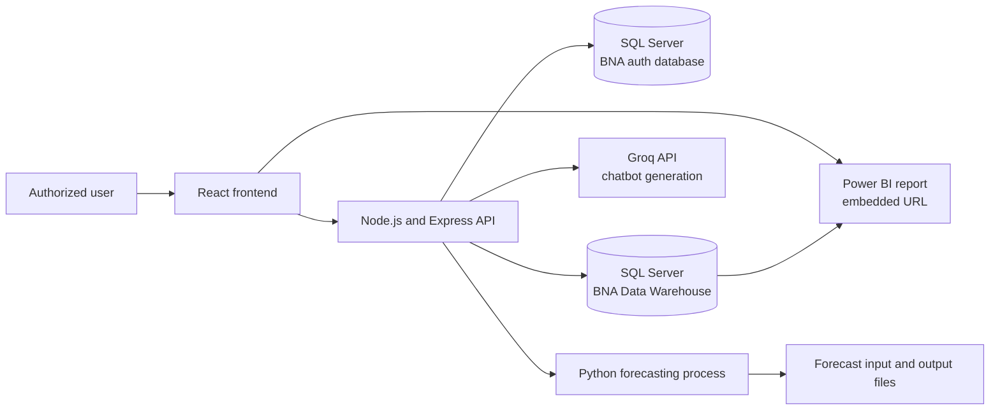
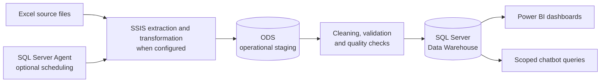
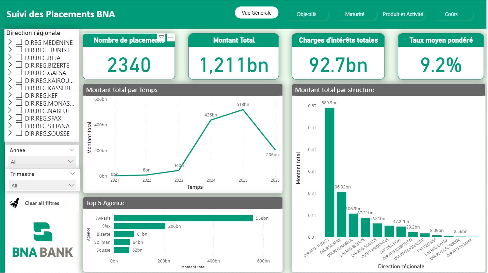
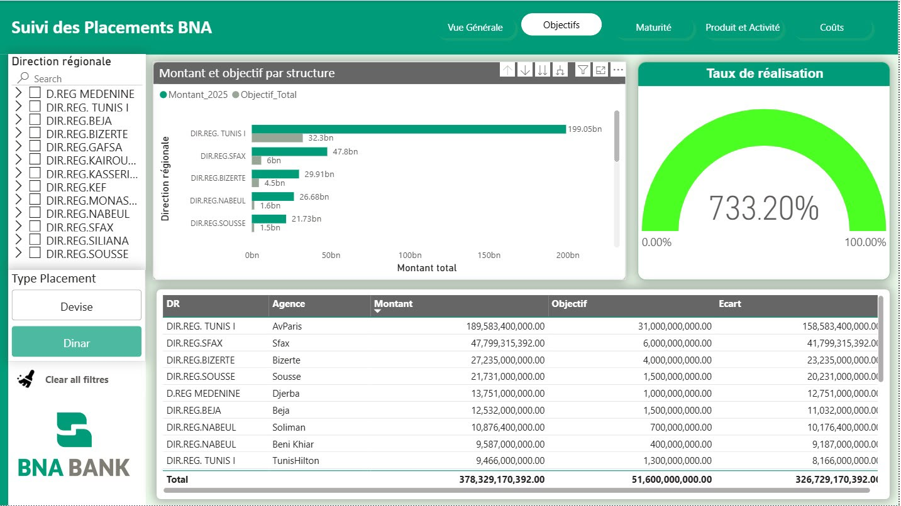
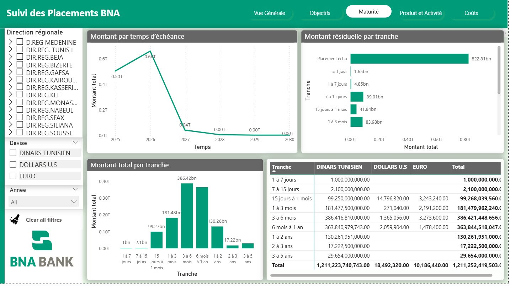
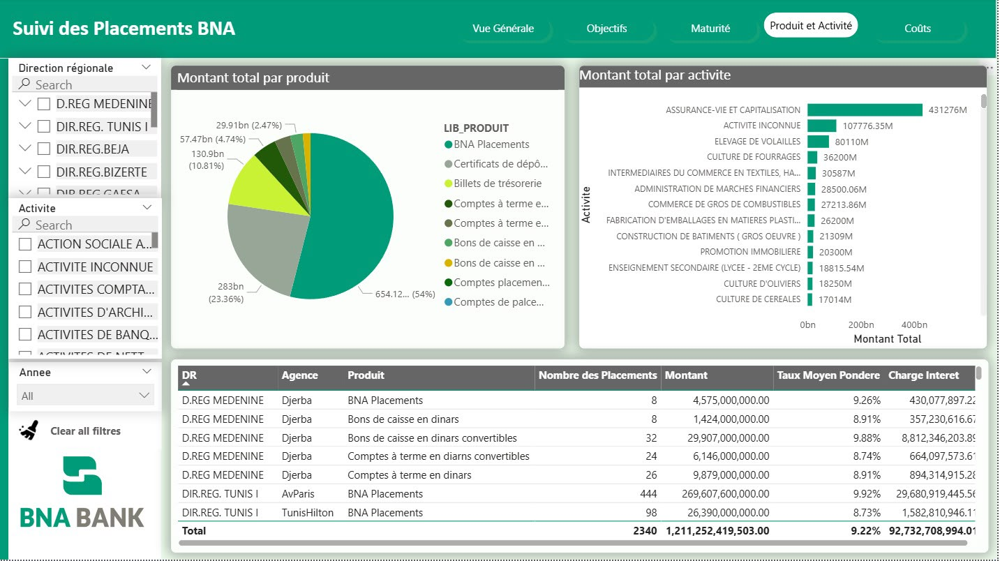
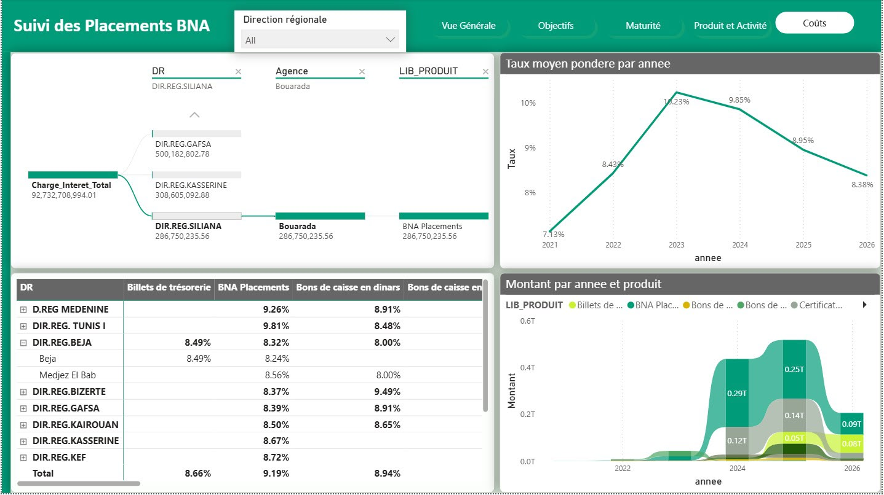
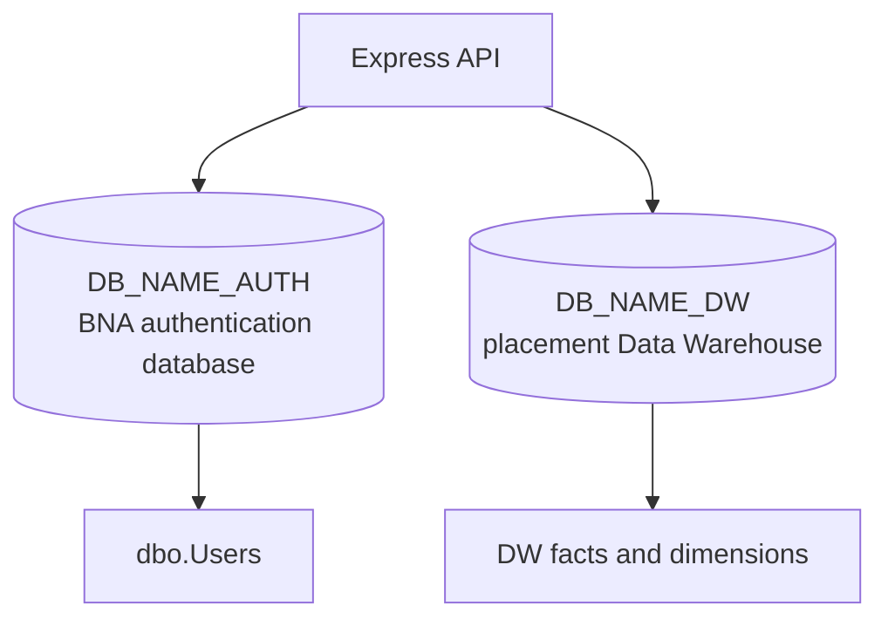
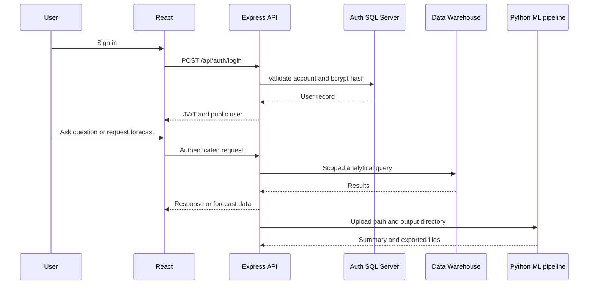

<p align="center">
  
</p>

<h1 align="center">
  BNA Platform - Intelligent Banking Investment Platform
</h1>

<p align="center">
  <strong>
    Web platform, business intelligence, conversational analytics and machine-learning forecasting for banking investments.
  </strong>
</p>

<p align="center">
  
  
  
  
  
</p>


---
## Table of Contents

- [Project Overview](#project-overview)
- [Business Context and Problem Statement](#business-context-and-problem-statement)
- [Project Objectives](#project-objectives)
- [Main Features](#main-features)
- [System Architecture](#system-architecture)
- [Part I - BNA Web Platform](#part-i---bna-web-platform)
- [Part II - Business Intelligence](#part-ii---business-intelligence)
- [Part III - AI Chatbot and Machine Learning](#part-iii---ai-chatbot-and-machine-learning)
- [Technology Stack](#technology-stack)
- [Database Architecture](#database-architecture)
- [Data Flow and ETL Pipeline](#data-flow-and-etl-pipeline)
- [Security and Access Control](#security-and-access-control)
- [Installation and Configuration](#installation-and-configuration)
- [Environment Variables](#environment-variables)
- [Running the Application](#running-the-application)
- [Project Structure](#project-structure)
- [Testing and Validation](#testing-and-validation)
- [Current Limitations](#current-limitations)
- [Future Improvements](#future-improvements)
- [Contributors](#contributors)
- [License](#license) 
## Project Overview

BNA Platform is an intelligent solution for managing, monitoring and analyzing bank investments. It combines an operational web application, a decision-support layer based on a SQL Server Data Warehouse and Power BI, a conversational assistant, and a machine-learning forecasting module.

The repository contains the React frontend, the Node.js/Express API and the Python forecasting pipeline. The SSIS packages, Power BI report authoring files and SQL Server deployment scripts are not versioned in this repository their availability and configuration can be found in their respective repositories.

## Business Context and Problem Statement

Investment data is often distributed across operational systems, spreadsheets and reporting workbooks. This makes it difficult to maintain a consistent view of amounts, objectives, maturities, currencies and performance across branches and regional structures.

BNA Platform addresses this situation by providing:

- A centralized interface for authenticated users and administrators.
- A common operational API connected to SQL Server.
- A Data Warehouse-oriented view of placements and objectives.
- Embedded Power BI reporting for consolidated decision support.
- A chatbot that translates authorized natural-language questions into controlled analytical queries.
- A forecasting workflow for historical placement data.

## Project Objectives

1. Centralize placement-related operational workflows.
2. Enforce role-based access to users, messages, forecasts and analytical data.
3. Improve visibility into investment amounts, objectives, currencies and maturity.
4. Reduce manual reporting and spreadsheet-based consolidation.
5. Provide controlled natural-language access to Data Warehouse indicators.
6. Compare forecasting models and expose their results to authorized users.
7. Establish a foundation for future integration between operational data, BI dashboards and predictive analytics.


## Main Features

| Area | Confirmed capabilities in this repository |
| --- | --- |
| Authentication | Login, JWT issuance, token verification, session refresh and logout |
| Account security | bcrypt password hashing, active/inactive status, mandatory first-login password change |
| User administration | Admin-only listing, filtering, creation, update and deletion workflows |
| Organizational scope | Agency, regional direction, central direction and administrator roles |
| Messaging | Authenticated user messaging and administrator message management |
| Notifications | Notification summary endpoints used by the frontend |
| BI access | Embedded Power BI report page configured in the React frontend |
| AI assistant | Authenticated natural-language questions, scoped SQL generation and SQL Server execution |
| Forecasting | CSV/Excel upload, Python training pipeline, model comparison, results and forecast preview |

## System Architecture



The frontend communicates with the backend through HTTP requests under `/api`. The backend maintains separate SQL Server connection pools for the authentication database and the Data Warehouse. The forecasting route starts the Python process and returns generated summaries and forecast outputs to the frontend.

## Part I - BNA Web Platform

### Purpose and Architecture

The web application centralizes access to investment information and related workflows. React provides the user interface and routing. Node.js and Express expose the API, enforce authentication and authorization, communicate with SQL Server, and orchestrate the Python forecasting process.

### Frontend

The frontend is a Create React App application using React 19, React Router and Recharts. Its confirmed pages and modules include:

- Login and session bootstrap.
- Mandatory first-login password change.
- Home and application layout with role-aware navigation.
- Power BI dashboard embedding.
- Forecast upload, training status, model comparison and visualizations.
- User management for administrators.
- User messaging and administrator message management.
- Floating chatbot available after authentication and after the mandatory password change.

### Backend

The Express API exposes the following route groups:

| Route | Responsibility | Access |
| --- | --- | --- |
| `/api/health` | API health check | Public |
| `/api/auth` | Login, current user and password change | Login is public; other endpoints require JWT |
| `/api/users` | User administration | JWT, completed password change and Admin role |
| `/api/chat` | Conversational analytical assistant | JWT and completed password change |
| `/api/messages` | User and administrator messaging | JWT and completed password change |
| `/api/notifications` | Notification summaries | API route protection applies according to implementation |
| `/api/forecast` | Upload, train, status, results and forecast preview | JWT and completed password change |

The server also configures CORS for the local frontend origins, parses JSON requests with a 1 MB limit, returns JSON errors and exposes a health endpoint.

### User Roles and Authorization

The implementation recognizes four roles:

| Role | Confirmed scope |
| --- | --- |
| `Admin` | User administration, administrator messaging and national analytical access |
| `Agence` | Access associated with the user's agency code |
| `Direction regional` | Access associated with the user's regional direction code |
| `Direction central` | National analytical access; assignable by the user API but not creatable as an additional Admin |

The user administration controller enforces a single protected administrator account in the current implementation. New users are created with a server-generated temporary password, stored as a bcrypt hash, and marked to change their password on first use. SMTP delivery is optional and depends on configuration.

### Authentication and Password Lifecycle

1. The user submits credentials to `POST /api/auth/login`.
2. The backend checks the account status and compares the password with its bcrypt hash.
3. A JWT containing the user identity, role and structure code is returned.
4. Protected requests send the token in `Authorization: Bearer <token>`.
5. The backend verifies the signature and expiration before authorizing the request.
6. Sensitive routes query the database to reject accounts whose `must_change_password` flag is still active.

The frontend locally checks the token expiration to avoid sending an obviously expired token; this is only a convenience check. Signature verification remains a backend responsibility.


## Part II - Business Intelligence

### Data Integration and ETL

The documented target flow is designed to transform source placement files into a queryable Data Warehouse:

1. Excel files are supplied as source data.
2. SSIS packages, when configured in the deployment environment, extract and validate the files.
3. Data is loaded into an Operational Data Store (ODS).
4. Cleaning and transformation standardize dates, amounts, currencies, structures, maturity and objectives.
5. Quality checks identify missing values, invalid formats, duplicates and inconsistent business attributes.
6. Validated data is loaded into the Data Warehouse.
7. SQL Server Agent can schedule the packages when job configuration is available.

The steps above describe the BI architecture :



### Data Quality Responsibilities

An operational ETL implementation should define rejection and remediation rules for:

- Missing or malformed subscription and maturity dates.
- Invalid amounts, rates, currencies or durations.
- Duplicate placement records.
- Unknown agencies, regional directions, products or maturity bands.
- Missing objectives or incompatible objective currency.
- Partial file loads and failed database transactions.


### Data Warehouse Model

The repository documents the following Data Warehouse structures:

| Table | Role |
| --- | --- |
| `DW.FAIT_PLACEMENT` | Main fact table; one row represents a financial placement according to the chatbot schema |
| `DW.FAIT_OBJECTIF` | Commercial or investment objectives by structure and year |
| `DW.DIM_TEMPS` | Calendar and date attributes, including subscription and maturity dates |
| `DW.DIM_STRUCTURE` | Agency and regional-direction attributes |
| `DW.DIM_MATURITE` | Contractual and residual maturity bands |
| `DW.DIM_PRODUIT` | Financial product attributes used by the chatbot schema |
| `DW.DIM_DEVISE` | Currency attributes used by the chatbot schema |
| `DW.DIM_ACTIVITE` | Economic activity attributes used by the chatbot schema |

The model follows a dimensional approach: facts hold measurable events and amounts, while dimensions provide the analytical axes. The exact physical keys and all relationships must be confirmed against the deployed SQL Server schema. The chatbot code explicitly references structure and time joins, including separate time aliases for subscription and maturity dates.

Relevant measures and attributes include placement amounts, interest rates, interest charges, effective duration, subscription dates, maturity dates, structures, currencies, contractual maturity, residual maturity and placement objectives. The implementation stores amounts in millimes in the documented fact schema and converts them for some chatbot displays; reporting conventions should be standardized in the BI layer.

### Power BI

The React dashboard embeds a configured Power BI report URL and provides a full-screen link. The following analytical views are appropriate to the documented model and are part of the intended BI scope:

- Placement amounts by agency, regional direction and structure.
- Actual performance compared with objectives.
- Objective achievement rate.
- Dinar versus foreign-currency analysis.
- Subscription dates, maturity dates and residual maturity.
- Interest rates, interest charges and placement duration.
- KPI cards, filters and interactive slicers.
- BNA-inspired visual identity.
#### Tableau de bord «Vue Générale »
<p align="center">
  
</p>

#### Tableau de bord «Objectifs »
<p align="center">
  
</p>

#### Tableau de bord «Maturité »
<p align="center">
  
</p>

#### Tableau de bord «Produit et Activité »
<p align="center">
  
</p>

#### Tableau de bord «Coûts »
<p align="center">
  
</p>
The business value of this layer is a more consistent performance view, less manual consolidation, faster monitoring and better support for operational and strategic decisions.

## Part III - AI Chatbot and Machine Learning

### AI Chatbot
<p align="center">
  
</p>


The chatbot is implemented as an authenticated assistant integrated into the React application and the Express API. It accepts a natural-language question, asks the configured Groq model to generate a T-SQL query based on an embedded Data Warehouse schema, executes the controlled query against SQL Server and returns a natural-language response.

The current implementation confirms the use of the Groq SDK and model name `llama-3.3-70b-versatile` in the backend. The assistant is not described as a general-purpose banking advisor; it is a controlled analytical interface for the documented BNA Data Warehouse.

#### Security and Scope Controls

- Chat requests require a valid JWT and a completed first-login password change.
- Agency users are restricted to their agency code.
- Regional-direction users are restricted to their regional code.
- Admin and central-direction users have national scope in the current scope service.
- The backend applies the territorial filter independently of the generated query.
- Generated SQL must start with `SELECT` and rejects data-modification, administrative, multi-statement and comment patterns.
- The chatbot prompt requires a structure join and includes business rules for dates, currencies, objectives and maturity.
- Conversation history is kept per authenticated user in server memory; it is not a persistent audit store.

Because the chatbot generates SQL, production deployment should add database least privilege, query timeouts, monitoring, prompt and output logging policies, and a review of any debug SQL exposure outside development.

### Machine Learning
<p align="center">
  
</p>

The forecasting component is confirmed as implemented. The frontend uploads `.csv`, `.xlsx` or `.xls` files, starts a training run through the backend, displays status and reads generated comparison and forecast outputs.

#### Confirmed Pipeline

- Input normalization for common date and amount column names.
- Optional placement-count, interest-rate and duration features.
- Date parsing, monthly alignment, duplicate removal and missing-date handling.
- Numeric conversion and interpolation for supported numeric series.
- IQR-based outlier treatment in the preprocessing flow.
- Temporal hold-out evaluation and five-fold `TimeSeriesSplit` evaluation when the data is sufficient.
- Model comparison and best-model selection.
- CSV and Excel export of model comparison, forecast horizon and cleaned history.

#### Confirmed Models and Metrics

| Model | Implementation |
| --- | --- |
| SARIMA | Seasonal `auto_arima` with monthly seasonality and a fallback SARIMA configuration |
| Random Forest | `RandomForestRegressor` with lag/feature-based forecasting helpers |
| XGBoost | `XGBRegressor` with lag/feature-based forecasting helpers |

The implemented metrics are RMSE and SMAPE. 
#### Integration Opportunities

The current forecast outputs are exposed through the platform's forecast page. 
## Technology Stack

| Layer | Technologies confirmed in the repository |
| --- | --- |
| Frontend | React 19, React Router, Recharts, Create React App |
| Backend | Node.js, Express 5, CORS, Multer |
| Authentication | JSON Web Tokens, bcryptjs |
| Data access | `mssql` and SQL Server |
| Chatbot | `groq-sdk`, configured Groq model |
| Email | Nodemailer, optional SMTP configuration |
| Machine learning | Python, pandas, NumPy, scikit-learn, pmdarima, XGBoost, openpyxl |
| Reporting | Power BI embedded report URL configured by the frontend |

## Database Architecture

The backend uses two configured SQL Server databases:



The authentication database contains `dbo.Users`, including identity, role, structure code, status, password hash and first-login password flag. The Data Warehouse connection is used by the chatbot and is the expected source for BI reporting. Database credentials must be provided through environment variables and must never be committed.

## Data Flow and ETL Pipeline

### Operational and Analytical Flow



The separate SSIS-to-ODS-to-Data-Warehouse flow is described in [Data Integration and ETL](#data-integration-and-etl). Its concrete packages and schedules must be supplied by the BI deployment.

## Security and Access Control

- JWT verification is enforced by Express middleware on protected routes.
- Passwords are hashed with bcrypt and are not returned in public user objects.
- Inactive accounts are rejected during login and current-user checks.
- First-login users cannot access sensitive business routes until the password is changed.
- Admin-only routes enforce the `Admin` role server-side.
- Chatbot scope is applied server-side and does not rely only on frontend filtering.
- SQL parameters are used for ordinary database operations such as login and scope lookup.
- Uploads are restricted to CSV/Excel extensions and 15 MB by the forecast route.
- Secrets and database credentials belong in environment variables.


## Installation and Configuration

The repository contains two Node.js packages and one Python environment. Install dependencies separately in each component.

```powershell
cd backend
npm install

cd ..\frontend
npm install
```

Install the Python dependencies from the checked-in requirements file in a Python environment:

```powershell
cd ..\ml-forecast
python -m pip install -r requirements.txt
```

Before starting the application, configure SQL Server databases, a database user, JWT settings and any optional integrations. 

## Environment Variables

The following names are read by the current code. Values are deployment-specific and must not be copied from this documentation.

| Variable | Purpose | Required when |
| --- | --- | --- |
| `PORT` | Express listening port | Starting the backend |
| `DB_SERVER` | SQL Server host | Database access |
| `DB_NAME_AUTH` | Authentication database name | Database access |
| `DB_NAME_DW` | Data Warehouse database name | DW access and chatbot |
| `DB_USER` | SQL Server login | Database access |
| `DB_PASSWORD` | SQL Server password | Database access |
| `JWT_SECRET` | JWT signing secret | Authentication |
| `JWT_EXPIRES_IN` | JWT lifetime accepted by the JWT library | Authentication |
| `GROQ_API_KEY` | Groq API credential | Chatbot |
| `PYTHON_PATH` | Python executable used by the backend | Forecast training |
| `FORECAST_OUTPUT_DIR` | Optional forecast output directory | Forecast customization |
| `FORECAST_UPLOAD_DIR` | Optional forecast upload directory | Forecast customization |
| `SMTP_DISABLED` | Disables SMTP when set to `true` or `1` | Optional email behavior |
| `SMTP_HOST` | SMTP server host | Welcome credential email |
| `SMTP_PORT` | SMTP server port | Welcome credential email |
| `SMTP_SECURE` | Enables secure SMTP mode | Welcome credential email |
| `SMTP_USER` | SMTP username and fallback sender | Welcome credential email |
| `SMTP_PASS` | SMTP password | Authenticated SMTP |
| `SMTP_FROM` | Sender address override | Welcome credential email |
| `FRONTEND_BASE_URL` | Frontend base URL used in email links | Welcome credential email |
| `FRONTEND_LOGIN_URL` | Optional explicit login URL in emails | Welcome credential email |
| `NODE_ENV` | Controls development-only chatbot debug SQL response | Runtime behavior |


## Running the Application

Start the backend in one terminal:

```powershell
cd backend
npm start
```

Start the React development server in another terminal:

```powershell
cd frontend
npm start
```


## Project Structure
<p align="center">
  
</p>


## Testing and Validation

- Check backend availability with `GET /api/health`.
- Verify login, JWT rejection and inactive-account behavior against a non-production database.
- Verify first-login route protection and successful password change.
- Verify each role with test accounts mapped to representative structures.
- Verify chatbot SQL restrictions and agency/regional scope using non-sensitive test data.
- Verify forecast upload validation, training status, generated summary and model comparison outputs.
- Run `npm run build` from `frontend` before a frontend deployment.


## Current Limitations

- A self-service forgotten-password/reset flow is not confirmed.
- Chat history is held in backend process memory and is lost when the server restarts.
- Forecast results depend on the uploaded data; no benchmark dataset or fixed score is included.
- No automated test suite, migration system or database deployment scripts are included.


## Future Improvements

1. Implement a secure forgotten-password workflow with expiring, single-use reset tokens.
2. Replace process-local chat history and forecast state with durable, access-controlled storage.
3. Add automated unit, integration, security and end-to-end tests.
4. Strengthen production controls with HTTPS, rate limiting, CSP, secret rotation, auditing and database least privilege.
5. Persist model versions, data lineage, training metadata and forecast monitoring results.
6. Publish validated predictions and confidence information to Power BI and operational screens.

## Contributors

This project was developed as a final-year academic project. Add the verified contributor names, affiliations and contact details before publishing:

| Contributor | Role | 
| --- | --- | 
| `Bejaoui Achref` | Project development | 
| `Haji Amel` | Academic supervision | 

## License
This project is distributed under the ISC License.
See [`LICENSE`](LICENCE)

## Achref Bejaoui

Master's student in Data Science, with a degree in Business Computing.

Areas of interest:

- Data Science
- Data Analytics
- Artificial Intelligence
- AI Agents
- Machine Learning
- Power BI
- Backend Engineering
- Data Engineering
  
[LinkedIn](https://linkedin.com/in/achref-bejaoui00) ·
[GitHub](https://github.com/Achref-004)
